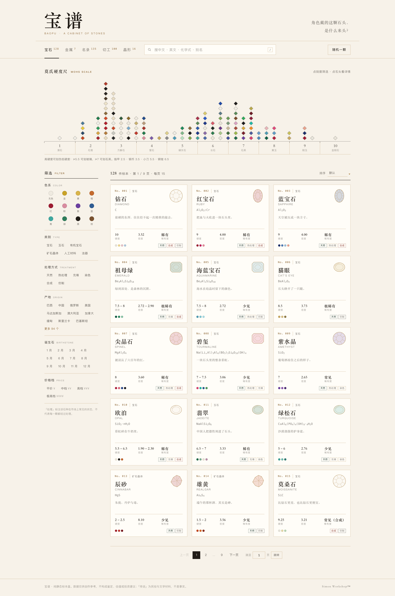
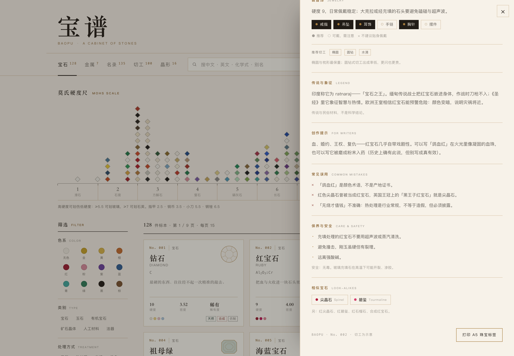
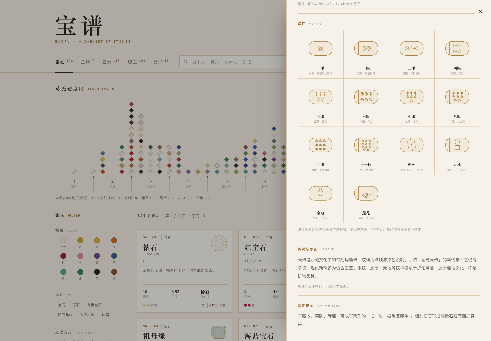
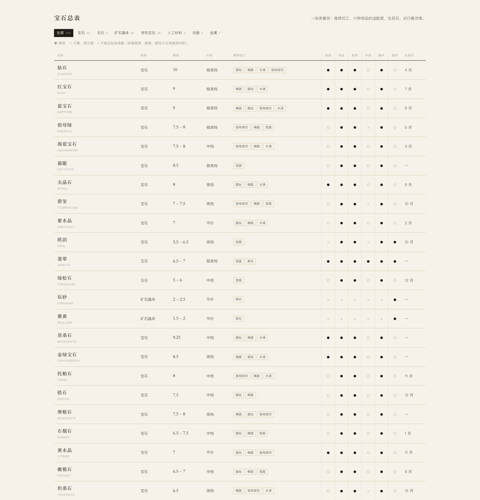
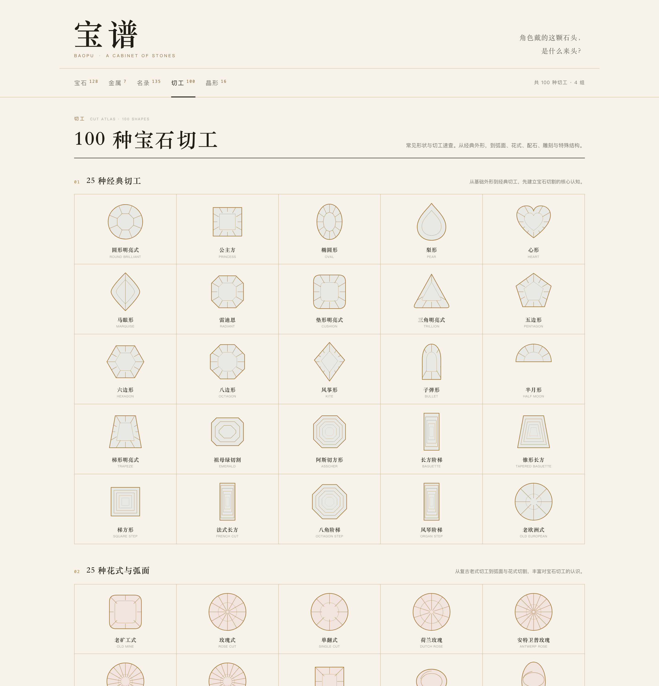
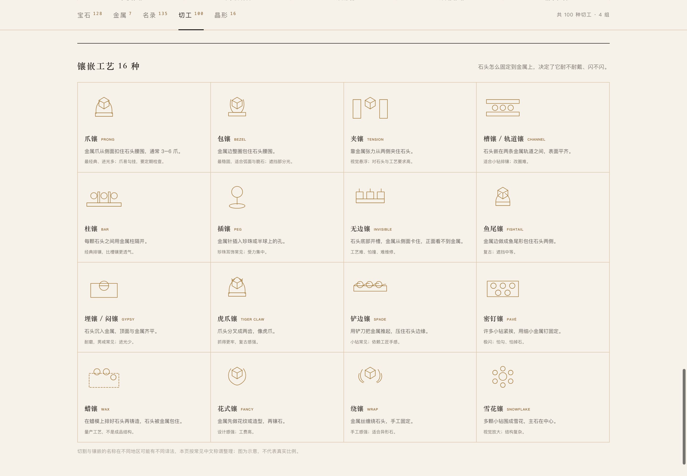
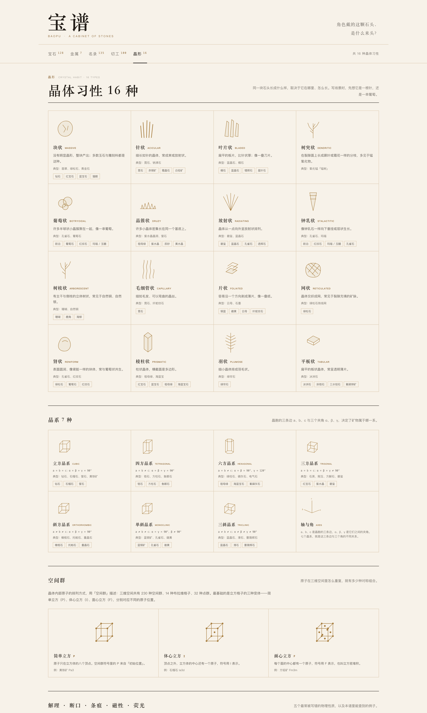
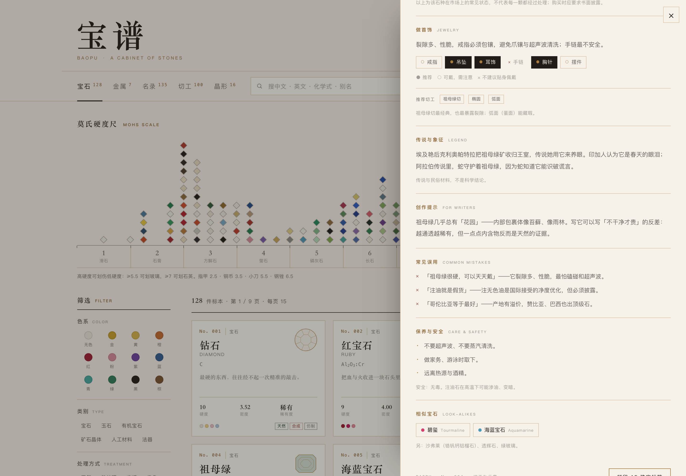
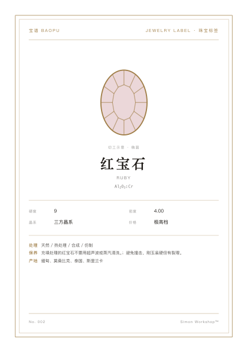
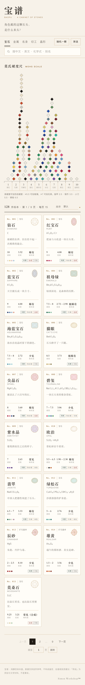

# 宝谱 BAOPU

> 角色戴的这颗石头，是什么来头？

一个纯静态的宝石 / 玉石 / 矿石晶体 / 有机宝石 / 贵金属资料库，面向原创角色写手、画手与考据党。
无框架、无构建、无外部依赖，双击 `index.html` 就能用。

## 预览



















移动端（390px）：



---

## 本地预览

**方式一：直接打开**

双击 `index.html`。数据通过 `<script>` 挂全局变量加载，不走 `fetch`，所以 `file://` 下也能正常显示。

**方式二：本地服务器（可选）**

```bash
cd 石谱
python3 -m http.server 8000
# 打开 http://localhost:8000
```

## 部署

把整个目录推到 GitHub 仓库，Settings → Pages → Source 选 `main` / 根目录即可。
没有构建步骤，也不需要 Node。

```
index.html
styles.css
app.js
data/gems.js
data/metals.js
```

---

## 已实现

| 功能 | 说明 |
| --- | --- |
| 莫氏硬度尺 | 1–10 横向标尺，宝石按硬度落点；点刻度筛选该区间；悬停/聚焦显示名称与硬度；过筛时其余落点变淡 |
| 颜色反查 | 12 个色系，选色即筛；色系来自每条数据的 `hues` |
| 搜索 | 中文名、英文名、化学式（含下标与无下标写法）、别名、元素符号；全库检索，宝石与金属一起出结果 |
| 筛选 | 类别、色系、处理方式、产地、诞生石、价格档；与硬度尺可叠加 |
| 详情抽屉 | 物性 / 产地与价格 / 处理与真伪 / 做首饰 / 传说与象征 / 创作提示 / 常见误用 / 保养与安全 / 相似宝石 |
| 名录（总账） | 第三个标签页：135 种的总数、按类别/产地/切工/生辰石的统计、克拉换算、净度分级、一张汇总全部条目的大表（可按类别筛） |
| 切工图鉴 | 第四个标签页：100 种切工，按经典 / 花式与弧面 / 创意 / 配石与特殊造型四组排列，全部为程序生成的 SVG 示意图；页尾另有 16 种镶嵌工艺（爪镶、包镶、夹镶、槽镶…），带线稿与适用提醒 |
| 晶形图鉴 | 第五个标签页：16 种晶体习性（每种配线稿与典型石种）、7 种晶系（晶胞图、轴角条件、典型石种）、空间群（简单/体心/面心立方格子）与物性速查 |
| 物理性质 | 解理分级、断口类型、条痕、磁性、荧光五张速查卡；详情页的物性区会显示该石头的晶体习性、条痕、磁性与荧光 |
| 克拉与黄金 | 克拉 → 克 / 分换算，填入当日金价可算等重黄金价值；附 K 金纯度对照 |
| 净度分级 | 钻石 GIA 11 级、彩色宝石的肉眼描述、翡翠种水与珍珠瑕疵度 |
| 饰品适配 | 每种石头对戒指/吊坠/耳饰/手链/胸针/摆件的适配度（● 推荐 / ○ 需注意 / × 不建议） |
| 陨石 | 橄榄陨石与铁陨石单独成条；铁陨石配「维斯台登纹」示意图，正文讲清纹路成因与鉴别 |
| 随机一颗 | 从当前结果中抽一颗，或在空结果时从全库抽 |
| 深链接 | `#/gem/ruby`、`#/metal/gold`、`#/ledger`，也兼容 `#ruby` |
| 分页 | 每页 15 条；支持输入页码直接跳转（回车或点「跳转」），越界自动夹到首页/末页；不足一页时自动隐藏 |
| 键盘 | `/` 聚焦搜索，`Esc` 关闭抽屉 / 清空搜索 |
| 打印 | 详情页「打印 A5 珠宝标签」，A5 竖版、含切工线稿与处理/保养/产地 |
| 移动端 | 390px 宽无横向滚动；筛选折叠为「筛选」面板 |

## 视觉规则

- 纸 `#F7F2E9`、墨 `#211C17`、金 `#A67C3D`、墨绿 `#1F3A32`；小字号金改为 `#8A6331` 以满足对比度。
- 标题宋体，正文无衬线；无渐变、无照片、无外部字体。
- 宝石图为程序生成的 SVG 切工线稿：圆钻 / 椭圆 / 祖母绿切 / 水滴 / 马眼 / 弧面 / 原石 / 铸锭。
  卡片上是细线稿，详情页丝绒带上是同一切工的实色版本；详情页标注「切工示意」。

## 扩展数据

在 `data/gems.js` 或 `data/metals.js` 的数组里追加对象即可，页面会自动更新编号、筛选分类、硬度尺落点与色系。

关键字段：

- `id`：唯一，用于深链接与「相似宝石」引用
- `mohs: [min, max]`：决定硬度尺位置与刻度筛选
- `hues: ['red', ...]`：可选值见 `app.js` 顶部 `HUES`
- `market: ['天然', '热处理', '充填', '染色', '合成', '仿制']`：卡片角标与「处理方式」筛选
- `cut` / `cuts`：可引用 `app.js` 里 `CUTS` 的任意 id（100 种切工），以及数据专用的 `raw`（原石）、`ingot`（铸锭）、`meteorite`（维斯台登切片）、`pallasite`（橄榄陨石切片）
- `cuts: ['oval', 'round']`：推荐切工，会出现在总表与详情页
- `jewelry: { ring: 2, pendant: 2, earring: 2, bracelet: 1, brooch: 2, display: 1 }`：
  `2` 推荐 / `1` 可戴但需注意 / `0` 不建议，会生成总表的六个符号列
- `jewelryNote`、`cutNote`：详情页「做首饰」里的说明
- `similar: ['ruby', ...]`：引用其它条目的 `id`；不存在的相似石写进 `similarExtra`

## 数据口径与已知不确定

- **价格**：公开市场的大致区间，随品质、产地、证书波动极大，仅供写作参考，不是报价。
- **硬度**：矿物学参考值。翡翠、绿松石等集合体按常见范围给出区间。
- **产地**：只列主要来源，不是完整清单。
- **处理**：`market` 表示该石种在市场上**常见**的状态，不代表每一颗都经过处理；详情页已注明。
- **传说**：民俗与文学材料，页面标注「不是科学结论」；不涉及任何疗愈、能量、功效说法。
- **毒性**：辰砂（含汞）、雄黄（含砷）标注「有毒，不要切割、加热或入口」。
- **收录范围**：现为 128 种宝石 + 7 种金属，共 135 条。含 48 种宝石、9 种玉石、48 种矿石晶体、20 种有机宝石、1 种人工材料（琉璃）、2 种法器（天珠、嘎巴拉）；金属含金、银、铂、铜、18K 金、玫瑰金、钛钢。
- **危险材料**：犀角、鲸牙、海象牙、龟甲、玳瑁、象牙、盔犀鸟头骨、海柳都标注了 CITES 附录与国内法限制，饰品适配全部为 0；详情页给出替代材料建议。人骨念珠「嘎巴拉」同样标为不可交易，只作文化介绍。
- **合法角材**：牛角、牦牛角、鹿角来自家畜或可再生的鹿角，作为象牙/犀角的替代材料收录，可正常使用。
- **矿物标本**：矿石晶体类以收藏标本为主，多数硬度低、含铅/砷/锑/铀或对光、热敏感，饰品适配普遍标为「不建议」，详情页写明了处置与保存要求。
- **切工图鉴**：100 种切工的名称、分组与示意图形；图形是按轮廓 + 刻面类型程序生成的速查图，不是精确的琢型图纸。
- **镶嵌工艺**：16 种常见镶嵌方式的线稿、做法与注意点；从切工页头部的「镶嵌工艺 ↓」可直接跳转。
- **受管制材料**：象牙（CITES 附录 I，中国禁止商业贸易）、玳瑁（CITES 附录 I）、砗磲（CITES II）、野生珊瑚均标注了法规与替代建议，饰品适配全部标为「不建议」。
- **同一矿物的不同品种**：猫眼与金绿宝石、帕帕拉恰与蓝宝石分列为条目，方便按贸易名检索；正文里注明了它们的从属关系。
- **饰品适配**：是编辑判断，不是行业标准；依据硬度、解理、脆性与日常磨损给出，同一石种的不同品质（是否充填、是否有裂）会改变结论。
- **净度**：钻石用 GIA 11 级；彩色宝石没有统一分级，页面给的是市场通用描述，不等于任何证书结论。翡翠的「种水」讲透明度与结构，不是净度。
- **克拉换算**：1 克拉 = 0.2 克是定义值；黄金价格随行情波动，页面不内置价格，需要自己填当日金价。

## 免责声明

本站内容不构成鉴定、估值或投资建议。

---

Simon Workshop™
